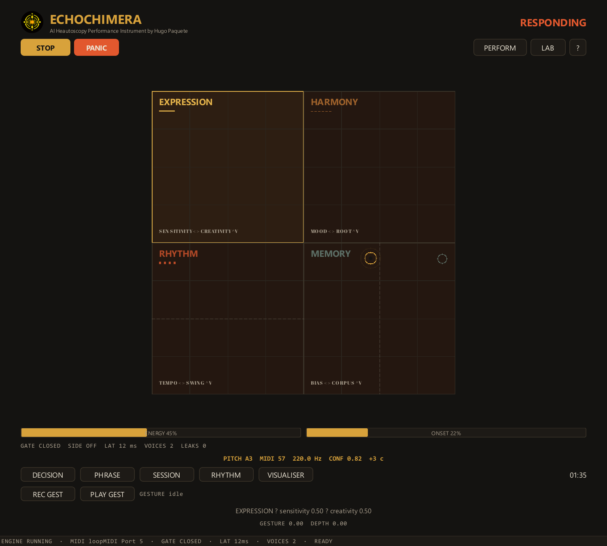

# ECHOCHIMERA: AI Heautoscopy Performance Instrument

**AI Heautoscopy Performance Instrument**  
Hugo Paquete · INET-md / University of Aveiro and Absonus Lab  
AI as Catalyst / Transformative Impacts on Digital Performance, Computer Music, and Cultural Creativity · 2026

This repository is the **public documentation** for ECHOCHIMERA. It
contains no source code, executable, build artefacts or user data.

## What is ECHOCHIMERA?

ECHOCHIMERA is a real-time MIDI instrument for human–AI performance. It
listens to a performer, decides whether to answer, chooses one of seven
musical characters, and performs a bounded phrase — or silence.

The instrument is a study in **constrained agency**:

- the system can answer, wait or refuse;
- silence is a musical response;
- every answer is limited by a response contract;
- every note is tracked and closed;
- the interface makes decisions visible.

## Public documentation

| Page | Contents |
|---|---|
| [Concept](concept.md) | problem, hypothesis, contribution |
| [Architecture](architecture-public.md) | high-level system and data flow |
| [Music theory](music-theory-public.md) | characters, scales, harmony, rhythm |
| [Performance theory](performance-theory.md) | listening, agency, silence, error, stage |
| [Evaluation](evaluation.md) | what was measured and what was not |
| [Paper](paper.md) | technical report |
| [Gallery](gallery.md) | interface and activity |
| [Press kit](press-kit.md) | short description and credits |

## Source code and executable

The source code is **not public**. The executable is distributed
separately as a controlled release.

See [Access policy](access-policy.md) for peer-review and research access.

## Cite

See [CITATION.cff](CITATION.cff).

## Licence

Documentation and images: [CC BY-NC-ND 4.0](LICENSE-DOCS.md).
Software and source: proprietary, all rights reserved; no source licence
is granted by this repository.

## Funding

FCT — CEEC Individual Scientific Employment Grant.  
See [Funding](funding.md).

## Contact

<https://www.hugopaquete.com>

