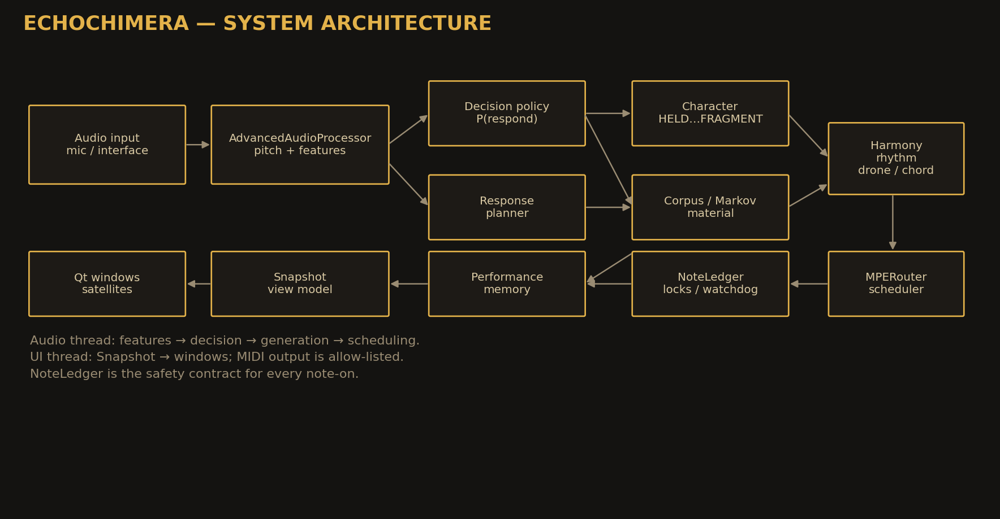
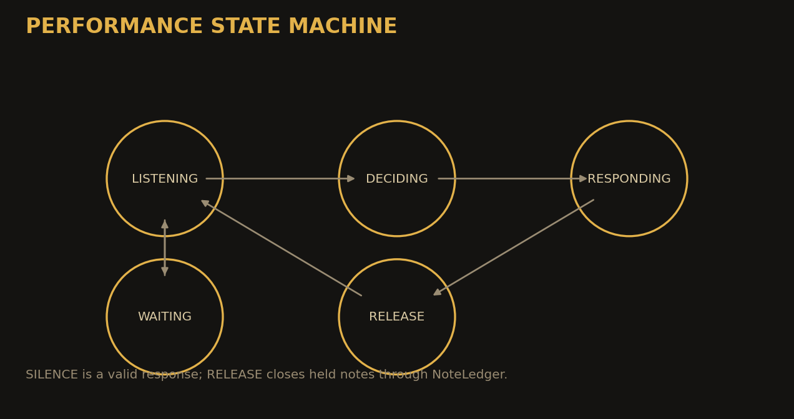

# Architecture

This is a public, conceptual view. It intentionally omits classes,
formulae and implementation details.

## System overview



```text
performer
  → audio input
  → feature analysis
  → decision: answer / wait / silence
  → response contract
  → character
  → corpus and/or Markov material
  → harmony, rhythm, drone, chord
  → MIDI router
  → synthesizer
  → sound
```

A snapshot layer feeds the interface. The UI does not read live audio
buffers; it observes the system's state.

## Layers

| Layer | Public description |
|---|---|
| audio | pitch, energy, onset, timbre |
| decision | listen, gate, choose to answer or not |
| contract | bound duration, starts, event count and tail |
| character | seven modes with different density and silence |
| material | corpus retrieval and statistical continuation |
| harmony | scale, chord, voicing and register |
| rhythm | 4/4 grid, patterns and accents |
| MIDI | notes, CC, pitch bend and aftertouch only |
| safety | note ledger, all-off and panic |
| interface | QuadPad, Decision, Phrase, Session, Rhythm, Visualiser, Console, Lab |

## State



States: listening, deciding, responding, release and waiting. Silence is
a valid response.

## MIDI and safety

The output is allow-listed:

```text
note_on, note_off, control_change, pitchwheel, aftertouch
```

Program changes, bank selects, SysEx and MMC are blocked.

Default routing uses MIDI channel 10 for rhythm. The user chooses the
MIDI port; a generic MIDI/loopMIDI port is recommended.

The note ledger records note-on/off and closes stuck notes. `PANIC` is a
technical recovery and a performance gesture.

## Interface

The interface is part of the composition:

- QuadPad — performance surface;
- Decision — history of listening and outcomes;
- Phrase — last answer;
- Session — session log and timeline;
- Rhythm — 16-step grid;
- Visualiser — pitch, response and Markov trace;
- Console — runtime and MIDI monitor;
- Lab — routing, parameters, harmony, live control, CC, scenes, memory.

## What is not public

The source code, class structure, probability formulae, scheduler and
implementation details are private. Access for peer review or research
collaboration is described in [Access policy](access-policy.md).
