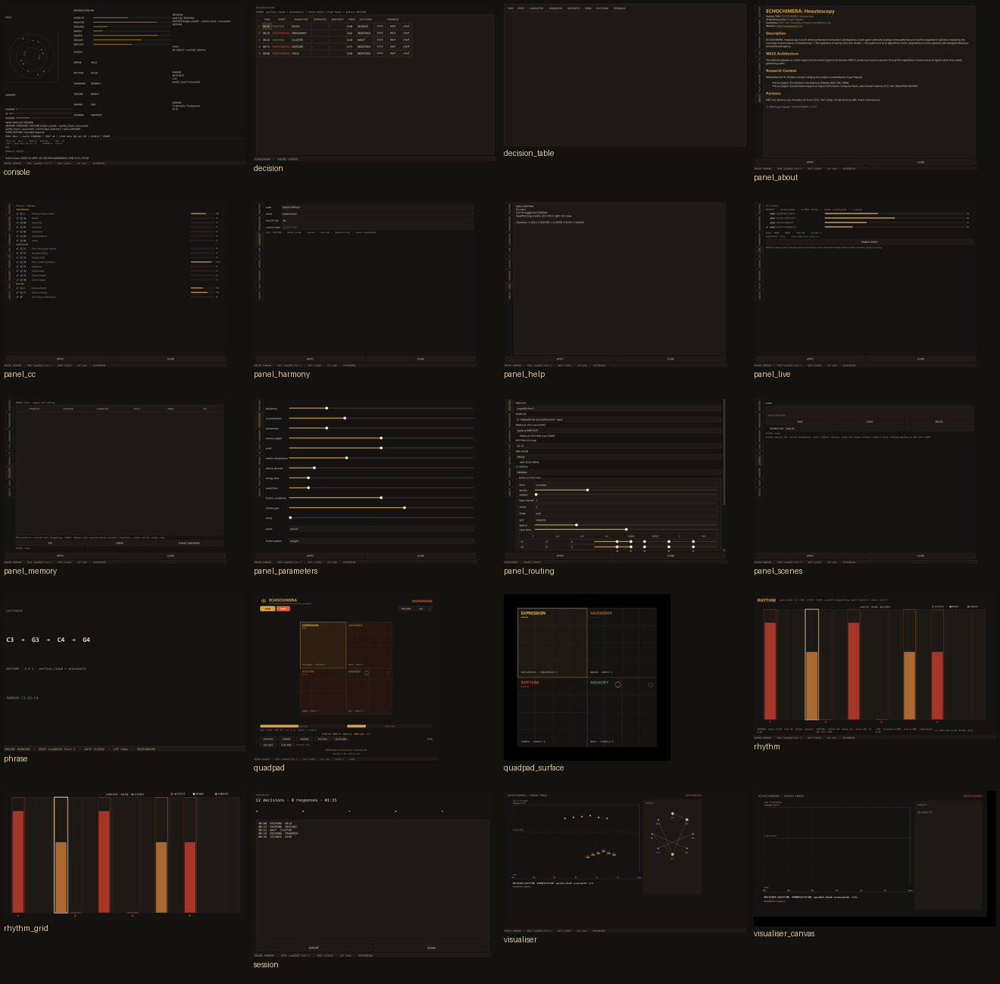

# ECHOCHIMERA

**AI Heautoscopy Performance Instrument**  
Hugo Paquete · INET-md / University of Aveiro and Absonus Lab  
2026

ECHOCHIMERA is a real-time MIDI instrument for human–AI performance. It
listens to a performer, decides whether to answer, chooses one of seven
musical characters, and performs a bounded phrase — or silence.

## The instrument

- seven characters: HELD, HELD_PULSE, GESTURE, CLUSTER, ECHO, FRAGMENT,
  SILENCE;
- a phenomenological corpus and a Markov model;
- scale-aware harmony and a 16-step rhythm layer;
- an allow-listed MIDI/CC contract and a note ledger;
- a visual performance surface with decision history and signal trace.

## Documentation

- [Concept](concept.md)
- [Artist statement](artist-statement.md)
- [Architecture](architecture-public.md)
- [Music theory](music-theory-public.md)
- [Performance theory](performance-theory.md)
- [Evaluation](evaluation.md)
- [Technical paper](paper.md)
- [Gallery](gallery.md)
- [Press kit](press-kit.md)
- [Credits](credits.md)
- [Funding](funding.md)
- [Access policy](access-policy.md)
- [Open science](open-science.md)
- [Citation](CITATION.cff)
- [Documentation licence](LICENSE-DOCS.md)

## Availability

The executable is distributed separately as a controlled release. The
source code is not public.

## Contact

<https://www.hugopaquete.com>
