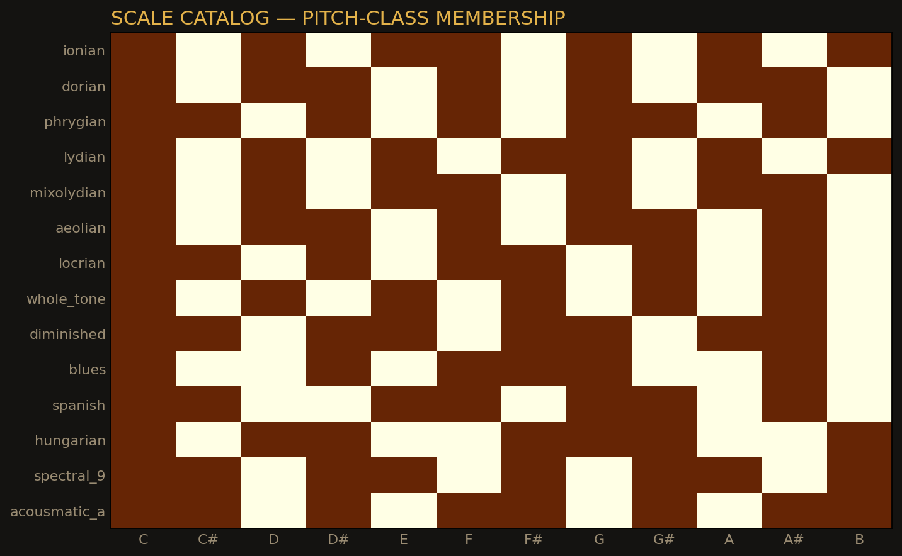
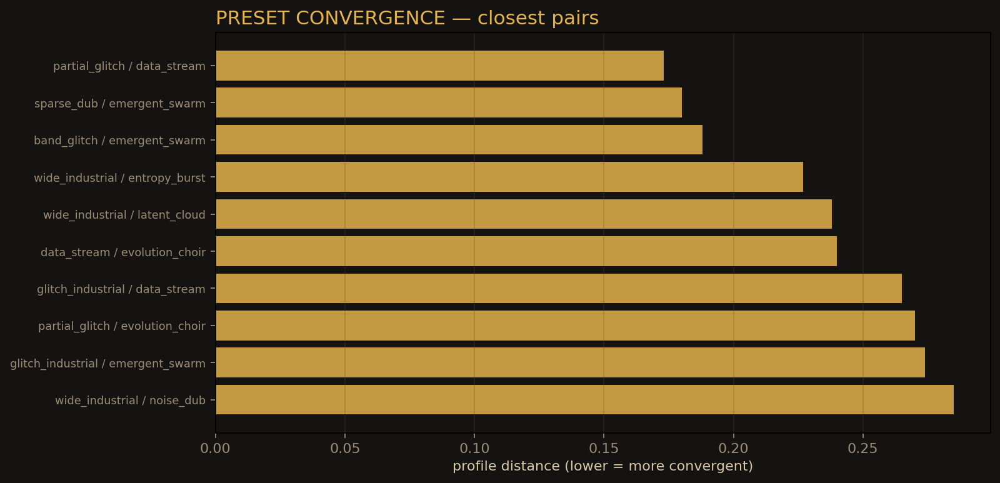

# Music theory

ECHOCHIMERA treats a response as a small composition:

```text
character → duration/density → harmony → pitch material
          → rhythm → articulation → register → contract
```

## Seven characters

| Character | Duration | Density | Silence | Articulation |
|---|---:|---:|---:|---|
| HELD | long | sparse | high | tenuto |
| HELD_PULSE | long | sparse, pulsed | high | tenuto |
| GESTURE | short | dense, wide | medium | staccato |
| CLUSTER | medium | dense, narrow | low | legato |
| ECHO | medium | medium | medium | normal |
| FRAGMENT | short | fragmented | medium | staccato |
| SILENCE | — | none | total | — |

Characters are not patches. They are behaviours.

## Scales

The instrument contains modal, synthetic, non-Western and microtonal
scale definitions. Tonal characters are constrained to the active scale;
gesture, noise and cluster material preserve their intervals before the
scale pass.



## Harmony

Harmony is explicit:

```text
root, scale, chord, function, tension, confidence
```

Voicing favours common tones and small motion. Chord extensions depend
on the harmonic density and complexity controls. Register is folded into
the configured range.

## Rhythm

The rhythm layer is a 16-step grid in 4/4.

- Markov material follows the selected pattern;
- corpus material keeps its own timing;
- accents and ghost notes shape velocity;
- `rhythm_gain` raises the rhythm lane;
- the Rhythm window states `timing grid` or `timing corpus`.

## Presets

Seventeen presets force an operator, an aesthetic and a corpus mix. They
are contexts, not synth patches:

```text
sparse_dub, wide_industrial, band_glitch, silence_ambient,
partial_acousmatic, sparse_spectral, partial_glitch, noise_dub,
mass_post, drone_ambient, glitch_industrial, data_stream,
cosmic_drone, evolution_choir, emergent_swarm, latent_cloud,
entropy_burst
```

## Preset convergence



Some presets are structurally close. Differentiation has been explored
through register, duration and density. The figure is a structural
measure, not an auditory verdict.

## Expression limits

Five presets use tonic-only material or intentional silence, so a scale
change is not audible there. This is a repertoire property, not a defect
of the scale engine.

## Safety as musical form

The response contract and note ledger are not only engineering. They
shape the music: maximum starts, tails, note closure and panic are part of
the instrument's form.
